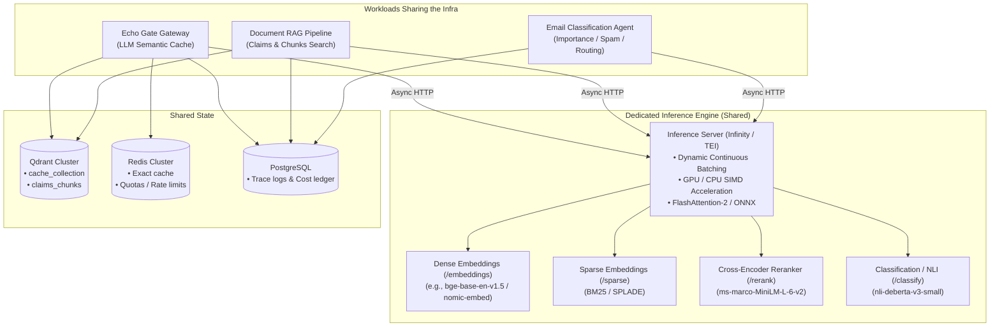

# Phase 3 Execution Plan: Performance, Cost of Serving & Shared Inference

This document contains the step-by-step implementation plan, architecture specifications, and cross-project integration blueprints for **Phase 3: Performance and Cost of Serving**.

It is designed to be fully self-contained so that any engineer, agent, or workstation can pick up the work at any step.

---

## 1. Objectives & Architectural Transformation

### Current State (Bottlenecks)
- **Monolithic In-Process ML**: PyTorch, Hugging Face Transformers, and SentenceTransformers run directly inside the FastAPI gateway process memory (`api/app/modules/embedding/embedding_service.py`, `api/app/modules/verifier/cross_encoder_service.py`).
- **Heavy Image Footprint**: Docker images are 5GB+ to 12GB (with CUDA). Cold starts take 30+ seconds.
- **Worker Duplication**: Each Uvicorn worker process duplicates model weights in RAM/VRAM.
- **Isolated Infrastructure**: ML capacity cannot be shared with other internal workloads (RAG pipelines, classification agents).
- **Uniform Eviction**: Cache cleanup indiscriminately deletes entries based on elapsed time (`expires_at < now`), dropping high-value reasoning outputs and cheap greetings equally.

### Target State (Phase 3 Deliverables)
1. **Decoupled Inference Microservice**: Core gateway image drops to <250MB. Embeddings, BM25, and cross-encoders are served by a dedicated containerized engine (Infinity / Hugging Face TEI) with dynamic batching and GPU/CPU acceleration.
2. **Shared Multi-Project Infrastructure**: The inference engine serves Echo Gate, a Document Claims RAG pipeline, and an Email Classification Agent without duplicate models.
3. **vCache Value-Aware Retention**: Cache entries receive economic retention scores based on saved provider dollar cost, saved latency, and token footprint.
4. **Pre-Flight Cost Estimation API**: `POST /api/v1/chat/estimate` provides instant token and dollar cost estimates across models using fast BPE token counting (`tiktoken`).
5. **Instant Streaming Cache Delivery**: Opt-in `X-Cache-Prefer: instant` header delivers full cached responses as single JSON bodies, skipping artificial SSE chunking overhead.
6. **Zero-Downtime Embedding Upgrade**: Dual-version coexistence and high-value background re-embedding runbook.

---

## 2. Shared Topology & Workload Matrix



### Shared Engine Endpoint Utilization

| Service Endpoint | Echo Gate Use Case | Claims RAG Pipeline Use Case | Email Classification Agent Use Case |
| :--- | :--- | :--- | :--- |
| `POST /embeddings` | Embeds user & system prompts for semantic vector matching. | Embeds document/policy chunks for dense vector search in Qdrant. | Embeds email text for semantic search and cluster analysis. |
| `POST /sparse` | Generates BM25 sparse vectors for hybrid RRF search. | Generates BM25 sparse vectors for keyword match on claim numbers / policy IDs. | *Optional keyword index.* |
| `POST /rerank` | Rescores candidate cached prompts against incoming prompt. | Rescores top-50 retrieved claim chunks to extract the top-5 for prompt context. | Rescores emails against class descriptions (zero-shot classification). |
| `POST /classify` | Contradiction / NLI detection between cached answer and prompt. | Contradiction check between generated claim summary and source chunks. | Classifies email intent: `Urgent`, `Spam`, `Billing`, `Archive`. |

---

## 3. Detailed Work Breakdown & Tracking Checklist

### Step 1: External Inference Microservice & Gateway Decoupling

- [x] **1.1 Compose Service Setup**:
  - Native host server for Mac M4 development (`inference-platform/` package, `uv run inference-platform` on port 7997 via `./dev/serve.sh`).
  - Production single-container Compose (`inference-platform/deploy/compose/inference.yml`) running Infinity on port 7997.
  - Production split-pool Compose (`inference-platform/deploy/compose/inference-split.yml`) running independent containers for embeddings (7997), reranking (7998), and classification/NLI (7999).
  - Health probes (`/health`), models lock (`models.lock.yaml`), and optional GPU resource reservations.

- [x] **1.2 Refactor `EmbeddingService` to Async HTTP Client**:
  - File: `api/app/modules/embedding/embedding_service.py`
  - Replaced in-process PyTorch with connection-pooled `InferenceClient`.
  - BM25 kept local via `fastembed` with explicit baked cache path `FASTEMBED_CACHE_PATH`.
  - Fail-open logging so inference downtime degrades to provider path.

- [x] **1.3 Refactor `CrossEncoderService` to Async HTTP Client**:
  - File: `api/app/modules/verifier/cross_encoder_service.py`
  - File: `api/app/modules/reranking/reranker_service.py`
  - Replaced in-process PyTorch `CrossEncoder` with async calls to `POST /rerank` and `POST /classify`.
  - Support per-role URL resolution (`INFERENCE_EMBED_URL`, `INFERENCE_RERANK_URL`, `INFERENCE_NLI_URL`) and independent timeouts.

- [x] **1.4 Strip Heavy Dependencies & Verify Image Sizing**:
  - Moved `sentence-transformers`, `torch`, `transformers` into optional `local-models` extra.
  - Core gateway image drops from 9.4GB to 0.71GB.

- [x] **1.5 Unit & Integration Verification**:
  - Comprehensive unit test suite in `tests/test_inference_client.py` covering wire shapes, error classification, role routing, per-role URL splitting, timeouts, and multi-endpoint probing.
  - 313 unit tests passed, compileall passed, OpenAPI contract verified.

---

### Step 2: vCache Economic Value Retention & Eviction

- [x] **2.1 Schema & Metadata Enrichment**:
  - File: `api/app/modules/qdrant/qdrant_schema.py`
  - File: `api/app/modules/qdrant/llm_cache_collection_service.py`
  - Extend Qdrant payload dictionary to store economic indicators:
    - `provider_cost`: Decimal / float (calculated from `get_model_prices`).
    - `latency_ms`: int (time saved by serving from cache).
    - `token_count`: int (`prompt_tokens + completion_tokens`).
    - `retention_value`: float (initial computed score).
    - `hit_count`: int (incremented on each cache hit).

- [x] **2.2 Dynamic TTL Calculation**:
  - Formula:
    $$TTL_{hours} = TTL_{base} \times \left(1 + \log_{10}(1 + \text{cost} \times 100)\right) \times \left(1 + \frac{\text{latency\_ms}}{1000}\right)$$
  - High-cost frontier outputs (e.g. Claude 3.7 Sonnet / o1) scale up to 14–30 days.
  - Cheap greetings / flash outputs default to 2–6 hours.

- [x] **2.3 Value-Weighted Eviction Celery Task**:
  - File: `api/app/modules/qdrant/tasks.py`
  - Replace naive `expires_at < now` hard cutoff with value-aware priority cleanup.
  - When storage capacity or vector count threshold is breached, query Qdrant points ordered by lowest `retention_value` and evict low-value entries first.

- [x] **2.4 Tests**:
  - Unit tests verifying TTL scaling curves for different models and latencies.
  - Verification that high-cost entries survive expiration while low-cost entries are evicted.

Implementation notes: the curves live in
`api/app/modules/qdrant/retention_policy.py` (`estimate_provider_cost`,
`calculate_ttl_seconds`, `compute_retention_value`) so they are I/O-free and
directly testable. `QdrantPayload` gained `provider_cost`, `latency_ms`,
`token_count`, `retention_value`, and `hit_count` (indexed for filters and for
`order_by`); `record_hit` is the background hit counter/score refresh. The sweep
in `delete_expired` is now three passes: unprotected expired, grace-expired, and
capacity overflow ordered by lowest `retention_value`. Controls are
`CACHE_RETENTION_ENABLED`, `CACHE_RETENTION_MAX_TTL_SECONDS`,
`CACHE_RETENTION_PROTECT_THRESHOLD`, `CACHE_RETENTION_GRACE_PERIOD_SECONDS`, and
`CACHE_RETENTION_MAX_POINTS` (documented in `docs/CONFIGURATION.md`);
`CACHE_RETENTION_ENABLED=false` restores the flat TTL sweep. Tests:
`tests/test_retention_policy.py` (14 cases, including a fake Qdrant that applies
the eviction filters).

---

### Step 3: Response Cost Estimation Endpoint (`POST /api/v1/chat/estimate`)

- [ ] **3.1 Lightweight Tokenizer Integration**:
  - Add `tiktoken` to `pyproject.toml` (Rust-based BPE tokenizer, fast, no PyTorch).
  - Create helper `count_tokens(text: str, model: str) -> int` in `api/app/core/helpers.py`.

- [ ] **3.2 Cost Estimation Service**:
  - File: `api/app/modules/chat/chat_estimate_service.py`
  - Compute prompt tokens across message array and tool declarations.
  - Estimate completion tokens based on `max_tokens` or intent history.
  - Look up provider rates from `api/app/core/pricing.py`.
  - Return comparison matrix across enabled models (`cost_prompt`, `cost_completion`, `cost_total`).

- [ ] **3.3 Controller & Route Registration**:
  - File: `api/app/modules/chat/chat_controller.py`
  - Expose `POST /api/v1/chat/estimate`.
  - Mount under `api_v1_router`.

- [ ] **3.4 OpenAPI Snapshot Update**:
  - Regenerate snapshot in `tests/snapshots/openapi.json`.
  - Verify via `tests/test_openapi_snapshot.py`.

---

### Step 4: Streaming Cache Hit Optimization (`X-Cache-Prefer: instant`)

- [ ] **4.1 Request Header Parsing**:
  - File: `api/app/modules/chat/chat_controller.py`
  - Read `X-Cache-Prefer` header. Check if value is `instant`.

- [ ] **4.2 Instant Response Delivery on Cache Hit**:
  - File: `api/app/modules/llm/llm_router_service.py`
  - When `is_cache_hit` is true and `request.stream` is true:
    - If `X-Cache-Prefer: instant` is set: immediately return a single `ChatCompletionResponse` JSON body with `X-Cache: HIT`, skipping `response_to_stream_chunks`.
    - If header is absent: preserve existing SSE chunk replay behavior for UI clients needing typewriter effect.
  - On cache miss: proceed with live upstream SSE streaming normally.

- [ ] **4.3 Test Coverage**:
  - Add tests in `tests/test_streaming_support.py` testing `stream=True` with and without `X-Cache-Prefer: instant`.

---

### Step 5: Zero-Downtime Embedding Upgrade Pipeline

- [ ] **5.1 Migration Script Modernization**:
  - File: `api/app/scripts/migrate_embeddings.py`
  - Refactor to batch-call the remote inference container rather than local models.
  - Read points from `SOURCE_COLLECTION` in scroll batches (e.g. 100 points).
  - Extract original `system_prompt` and `user_prompt` from payload.
  - Call inference container `/embeddings` in parallel.
  - Upsert into `TARGET_COLLECTION` with updated `embedding_version`.

- [ ] **5.2 Migration CLI Options**:
  - Add flags: `--batch-size`, `--dry-run`, `--limit`, `--min-retention-value` (to migrate high-value entries first).

- [ ] **5.3 Documentation & Runbook**:
  - Document deployment coexistence procedure in `docs/DEVELOPMENT.md`.

---

## 4. Integration Blueprint for External Projects

### A. Document RAG Pipeline (Claims & Policy Search)
To ingest and search insurance/legal claims using this shared infrastructure:

1. **Ingestion Flow**:
   ```
   PDF Claims Documents
          │
          ▼
   Chunking (e.g. 500 tokens)
          │
          ├──► POST http://inference:7997/embeddings (Dense Vector)
          └──► POST http://inference:7997/sparse     (BM25 Sparse Vector)
          │
          ▼
   Upsert into Qdrant collection: `claims_knowledge_base`
   ```

2. **Search & Rerank Flow**:
   - Client sends user query: *"Has claim #4092 for water damage been approved?"*
   - Query is embedded via `POST http://inference:7997/embeddings` and `/sparse`.
   - Qdrant executes Hybrid RRF search, returning candidate top-30 chunks.
   - Send candidate chunks to `POST http://inference:7997/rerank` with query.
   - Top-5 reranked chunks are passed as context to the LLM completion prompt.

### B. Email Classification Agent (Triage & Labeling)
To classify incoming emails without running PyTorch:

1. **Classification Request Flow**:
   - Email Agent receives incoming email (Subject + Body).
   - Agent calls `POST http://inference:7997/classify`:
     ```json
     {
       "inputs": ["Subject: Urgent claim settlement delay for policy #1092..."],
       "parameters": {
         "candidate_labels": [
           "Urgent Claim Escalation",
           "Billing & Payments",
           "General Inquiries",
           "Spam / Marketing"
         ]
       }
     }
     ```
   - Inference container returns softmax confidence scores across candidate labels in <15ms.
   - If `Urgent Claim Escalation` > 0.85: Agent tags email `URGENT` and sends alert to Celery priority queue.
   - If `Spam / Marketing` > 0.90: Agent archives email immediately.

---

## 5. Verification Commands

When executing each step, run the following verification checks:

```bash
# 1. Syntax and import verification
poetry run python -m compileall api/app

# 2. Run unit test suite
poetry run pytest

# 3. OpenAPI contract validation
poetry run pytest tests/test_openapi_snapshot.py

# 4. Check Docker build size (target <250MB)
docker build -t echo-gate-api:phase3 -f deploy/compose/Dockerfile.api .
docker images echo-gate-api:phase3
```
